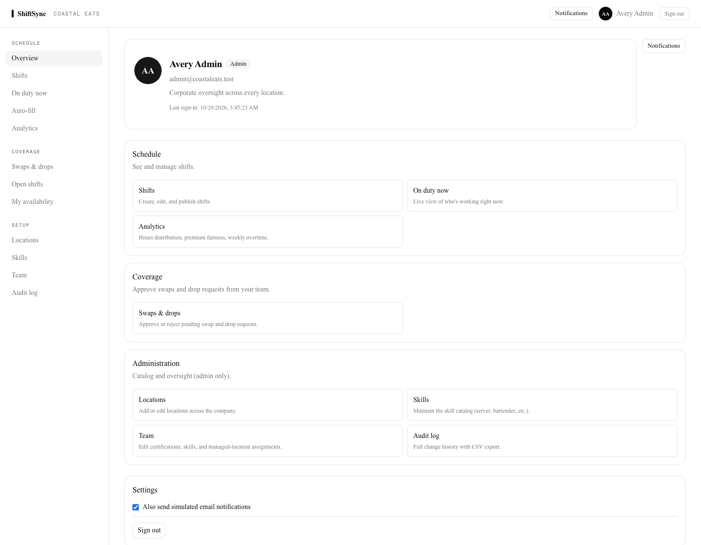
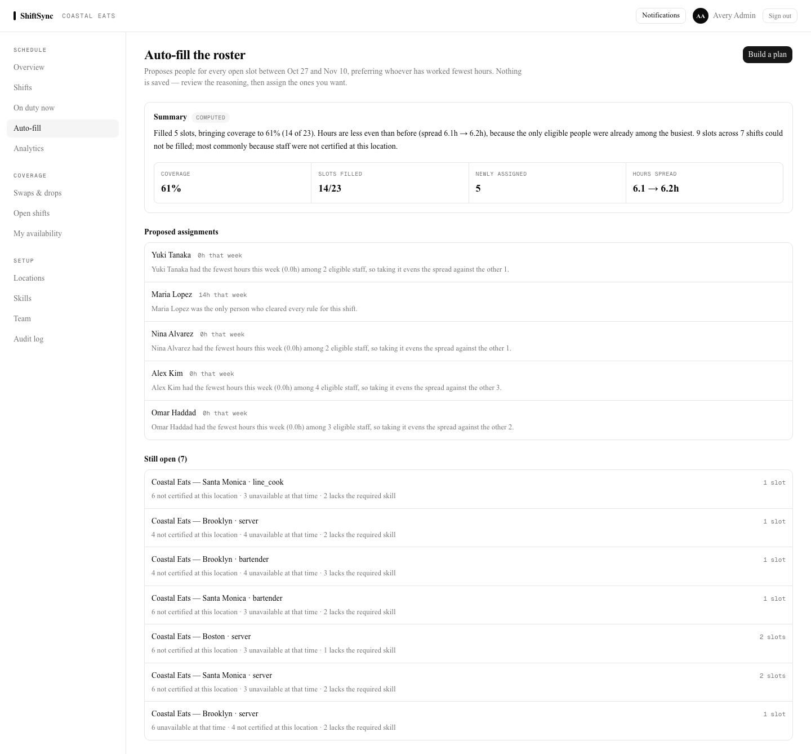
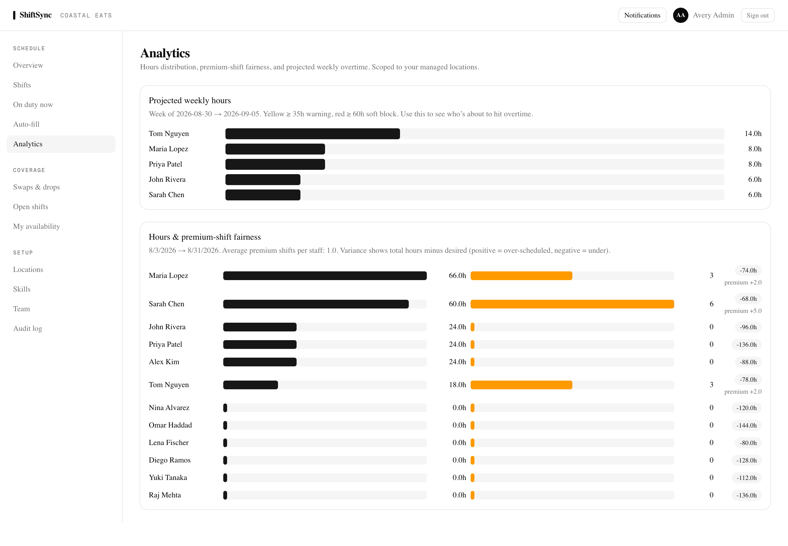
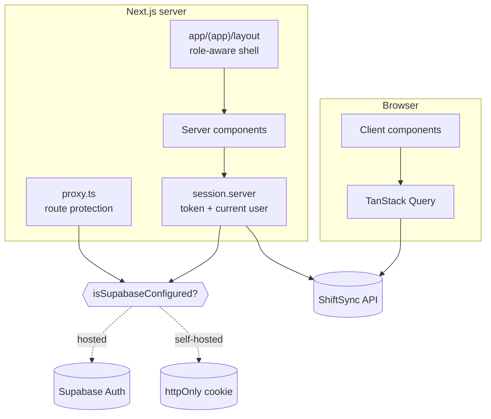

# ShiftSync — Web

Next.js front end for **ShiftSync**, a staff-scheduling tool for a restaurant
group with four sites across two timezones.

API: [staff-roster-api](https://github.com/dev-mnadeem/staff-roster-api)



---

## Run it

Both repositories must be cloned as siblings. From `staff-roster-api`:

```bash
docker compose up --build
```

Then open **http://localhost:3200** and sign in with a seeded account:

| Role | Email | Password |
|---|---|---|
| Admin | `admin@coastaleats.test` | `CoastalEats!2026` |
| Manager | `east-manager@coastaleats.test` | `CoastalEats!2026` |
| Staff | `sarah@coastaleats.test` | `CoastalEats!2026` |

No credentials to obtain — see the API's README for how identity resolves.

<details>
<summary>Running this app on its own</summary>

```bash
npm ci
cp .env.example .env      # point NEXT_PUBLIC_BACKEND_ENDPOINT at a running API
npm run dev               # :3000
```
</details>

---

## Two things worth looking at

### Auto-fill, with its reasoning shown



Every proposed assignment carries the sentence that justifies it — *"had the
fewest hours this week (0.0h) among 2 eligible staff"*, or *"was the only person
who cleared every rule for this shift"*. Slots that stay open list why, broken
down by how many staff each reason blocked.

The summary is badged **computed** or **written by model** so a reader always
knows which they are looking at. Nothing is saved until the manager assigns it.

### Fairness you can actually see



Hours and premium-shift distribution side by side, because "everyone works the
same hours" and "everyone takes a turn on Saturday night" are different
questions and a roster can pass one while failing the other.

---

## How it is put together



### Authentication has one seam

`isSupabaseConfigured()` is the only place that asks which mode is running.
Everything else — pages, the route proxy, the API clients — goes through
`getSessionUser()` and `getAccessToken()` and never knows the difference.

Self-hosted, the token lives in an **httpOnly** cookie so an injected script
cannot lift it from `document.cookie`. Client components that need it call a
same-origin route which returns it, cached briefly to avoid a round trip per
request.

Route protection in `proxy.ts` only decides *which page to show*. It is not
authorisation — every request the page makes is verified again by the API,
which holds the signing key.

### One shell, role-aware navigation

Every signed-in route lives under the `(app)` route group and shares one layout
that fetches the profile once and hides navigation the current role cannot use.

Each page used to end in a "Back to dashboard" link, so moving between sections
meant a round trip through the overview. A standing sidebar turns that into one
click and makes the whole product visible at once.

### Live updates degrade rather than break

`useTableChannel` subscribes to Postgres changes through Supabase Realtime when
it is configured. Without it, the same callback is driven on a 15-second
interval instead — consumers refetch either way, so no component knows which is
running. Polling is worse latency, not worse correctness.

---

## Stack

Next.js 16 (App Router, Turbopack) · React 19 · TypeScript (strict) ·
Tailwind v4 · shadcn/ui on Base UI · TanStack Query v5 · React Hook Form + Zod ·
`date-fns-tz` · Supabase Auth (optional)

## Configuration

| Variable | Purpose |
|---|---|
| `NEXT_PUBLIC_BACKEND_ENDPOINT` | API URL **as the browser sees it**; baked into the bundle at build time |
| `API_BASE_URL_INTERNAL` | API URL as the Next.js *server* sees it. Needed under Compose, where the browser uses `localhost:4000` but the web container must use `api:4000` |
| `NEXT_PUBLIC_SUPABASE_URL` / `..._PUBLISHABLE_KEY` | Leave blank for self-hosted identity |

That first pair being different is not incidental: a single URL cannot serve
both, and getting it wrong produces a login that fails only inside the
container.

## Known limitations

- **No dark theme.** Tokens exist for one, but no toggle is wired.
- **Polling, not push, when self-hosted.** A notification can be up to 15
  seconds late.
- **The shifts list is a flat list.** For a real week a manager wants a grid by
  day and location; the current view stays readable at ten shifts and would not
  at a hundred.
- **No end-to-end tests.** The API is well covered; this app is verified by
  hand and by the Playwright pass used to produce the screenshots above.

## Browser regressions

With the seeded API and this web app running, run:

```bash
E2E_BASE_URL=http://localhost:3200 E2E_PASSWORD='<your SEED_PASSWORD>' npm run test:e2e
```

The tests sign in as admin and staff, compute a roster proposal, and verify the staff
account cannot enter the manager planner. Use a disposable seed database. Desktop and
[mobile planner](docs/screenshots/planner-mobile.png) captures were taken from the native
app; the planner explanation in these captures is computed locally.
