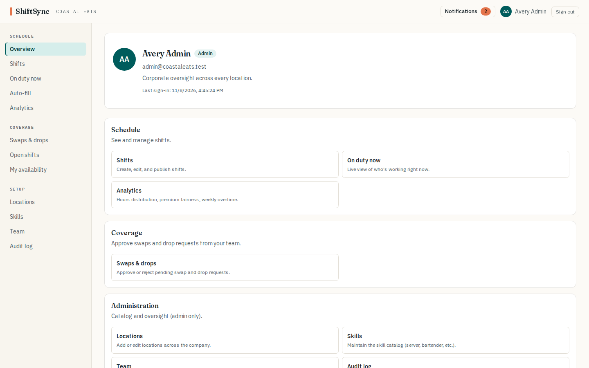
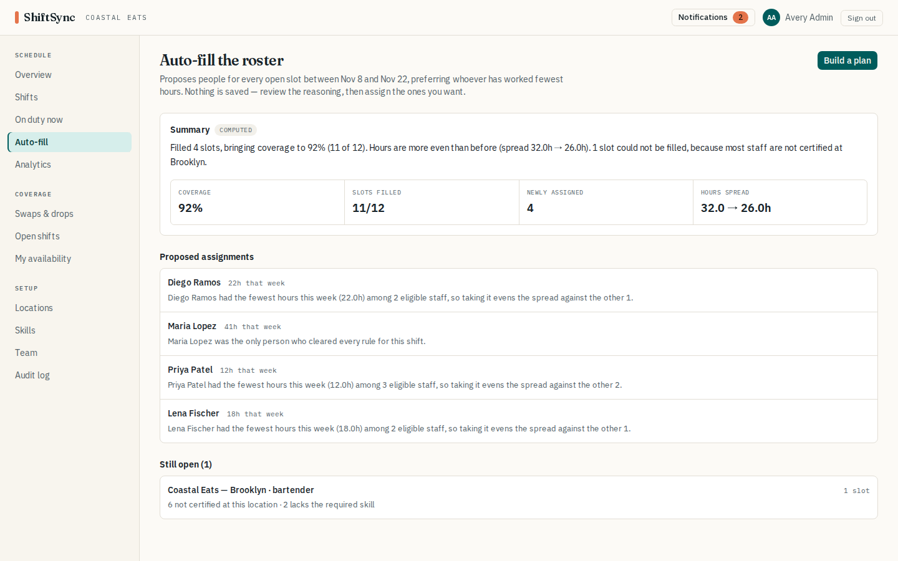
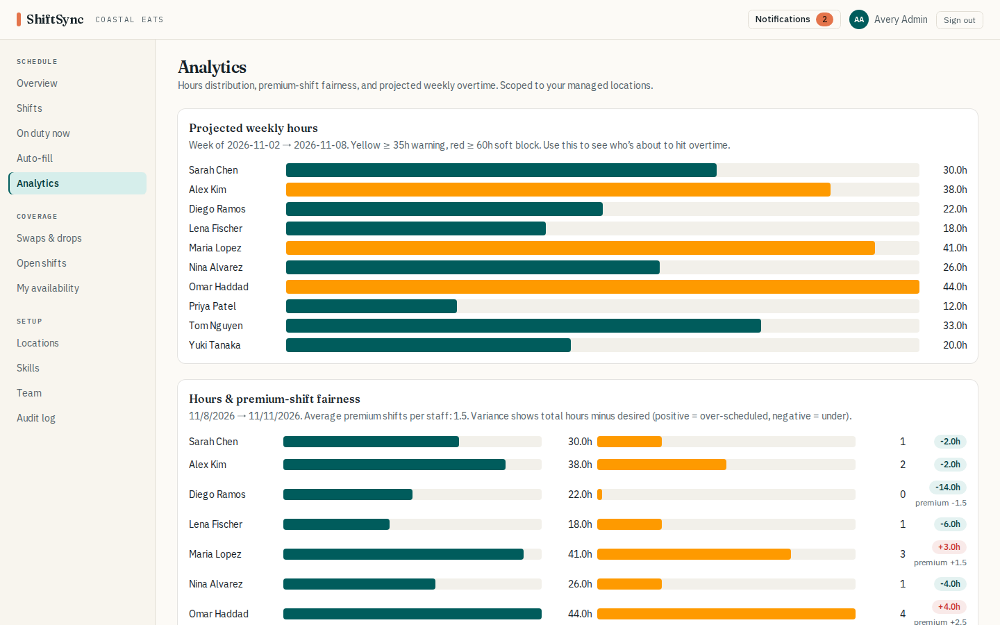
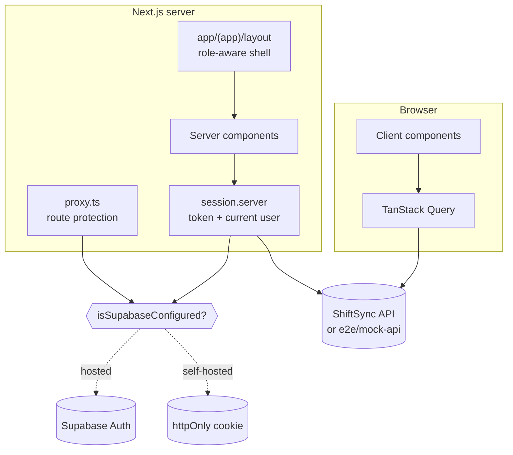
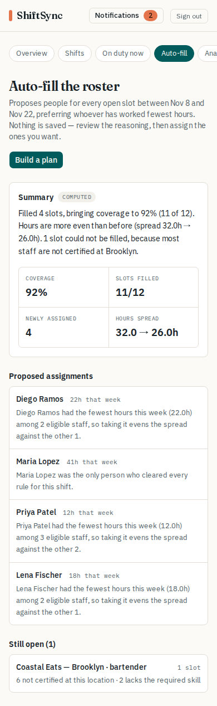

# ShiftSync — Web

Next.js front end for **ShiftSync**, a staff-scheduling tool for a restaurant
group with four sites across two timezones. Managers publish shifts and fill
them; staff set availability and trade shifts; everyone sees who is on duty
right now.

The API lives in a separate repository, `staff-roster-api`. This repository
also ships a small mock of it (`e2e/mock-api`), so the app can be run, tested
and screenshotted without the API or a database.



---

## Run it

### With the real API

Clone both repositories as siblings. From `staff-roster-api`:

```bash
docker compose up --build
```

Then open **http://localhost:3200** and sign in with a seeded account. The
password is the `SEED_PASSWORD` set in the API's `.env`:

| Role | Email |
|---|---|
| Admin | `admin@coastaleats.test` |
| Manager | `east-manager@coastaleats.test` |
| Staff | `sarah@coastaleats.test` |

See the API's README for how identity resolves.

### On its own, against the mock API

Needs Node 22 (`.nvmrc`).

```bash
npm ci
npm run mock-api          # terminal 1: fake API on :4010
NEXT_PUBLIC_BACKEND_ENDPOINT=http://127.0.0.1:4010/api npm run dev   # terminal 2
```

Open http://localhost:3000 and sign in as any address from the table above
with any password. The mock serves fictional Coastal Eats data built around the
current time, so "On duty now" and this week's analytics always have
something in them. Writes such as publishing a shift change in-memory state
only.

To point the app at a real API instead, copy `.env.example` to `.env` and set
`NEXT_PUBLIC_BACKEND_ENDPOINT`.

### As a container

```bash
docker build --build-arg NEXT_PUBLIC_BACKEND_ENDPOINT=http://localhost:4000/api -t shiftsync-web .
docker run -p 3000:3000 -e API_BASE_URL_INTERNAL=http://host.docker.internal:4000/api shiftsync-web
```

`API_BASE_URL_INTERNAL` is how the container's server reaches the API; the
browser keeps using the URL baked in at build time.

The image is a standalone Next.js server (about 340 MB) running as a non-root
user, with a health check on `/`.

---

## Two things worth looking at

### Auto-fill, with its reasoning shown



Every proposed assignment carries the sentence that justifies it, such as *"had the
fewest hours this week (12.0h) among 3 eligible staff"* or *"was the only
person who cleared every rule for this shift"*. Slots that stay open list why,
broken down by how many staff each reason blocked.

The summary is badged **computed** or **written by model** so a reader always
knows which they are looking at. Nothing is saved until the manager assigns it.

### Fairness you can actually see



Hours and premium-shift distribution side by side, because "everyone works the
same hours" and "everyone takes a turn on Saturday night" are different
questions, and a roster can pass one while failing the other.

---

## How it is put together



### Authentication has one seam

`isSupabaseConfigured()` is the only place that asks which mode is running.
Everything else (pages, the route proxy, the API clients) goes through
`getSessionUser()` and `getAccessToken()` and never knows the difference.

Self-hosted, the token lives in an **httpOnly** cookie so an injected script
cannot lift it from `document.cookie`. Client components that need it call a
same-origin route which returns it, cached briefly to avoid a round trip per
request.

Route protection in `proxy.ts` only decides *which page to show*. It is not
authorisation: every request the page makes is verified again by the API,
which holds the signing key. The `?next=` return path is only followed when it
is a path on this site (`shared/redirect.ts`), so a crafted sign-in link
cannot bounce someone to another origin.

### One shell, role-aware navigation

Every signed-in route lives under the `(app)` route group and shares one layout
that fetches the profile once and hides navigation the current role cannot use.
On wide screens the navigation is a grouped sidebar; on phones it collapses to
one scrollable row so the page itself starts near the top.



### Live updates degrade rather than break

`useTableChannel` subscribes to Postgres changes through Supabase Realtime when
it is configured. Without it, the same callback is driven on a 15-second
interval instead. Consumers refetch either way, so no component knows which is
running. Polling is worse latency, not worse correctness.

### Times belong to the location

Shift times are stored in UTC and always shown in the timezone of the site
they belong to, so a Brooklyn manager reading a Santa Monica shift sees
Pacific time, labelled as such. `lib/time/format.ts` holds the two
conversions, and they are unit-tested across daylight saving.

---

## Tests

```bash
npm test             # Vitest: 22 unit tests, no network
npm run typecheck
npm run lint
```

Browser tests run against the mock API, which Playwright starts alongside
`next start`. The API URL is baked into the bundle, so build for the mock
first:

```bash
NEXT_PUBLIC_BACKEND_ENDPOINT=http://127.0.0.1:4010/api npm run build
npx playwright install chromium   # once
npm run test:e2e     # 9 specs: sign-in, ?next= guard, role gates, nav, filters
```

They cover signing in and out, the off-site `?next=` guard, the planner's role
gate, navigation highlighting, the shift location filter and the on-duty view.
`CAPTURE_SCREENSHOTS=1 npx playwright test screenshots` regenerates the
images in `docs/screenshots/` at 1440×900 and 390×844.

To run the original browser checks against a real seeded API instead, use a
disposable database:

```bash
E2E_BASE_URL=http://localhost:3200 E2E_PASSWORD='<your SEED_PASSWORD>' npm run test:e2e
```

---

## Stack

Next.js 16 (App Router, Turbopack) · React 19 · TypeScript (strict) ·
Tailwind v4 · shadcn/ui on Base UI · TanStack Query v5 · Zod · `date-fns-tz` ·
Supabase Auth (optional) · Vitest · Playwright

Type is IBM Plex Sans and Plex Mono for the working UI, with Fraunces for
page titles. The palette pairs sea-glass teal for actions with coral for the
things that need attention.

## Configuration

| Variable | Purpose |
|---|---|
| `NEXT_PUBLIC_BACKEND_ENDPOINT` | API URL **as the browser sees it**; baked into the bundle at build time |
| `API_BASE_URL_INTERNAL` | API URL as the Next.js *server* sees it. Needed under Compose, where the browser uses `localhost:4000` but the web container must use `api:4000` |
| `NEXT_PUBLIC_SUPABASE_URL` / `..._PUBLISHABLE_KEY` | Leave blank for self-hosted identity |

That first pair being different is not incidental: a single URL cannot serve
both, and getting it wrong produces a login that fails only inside the
container. An empty `API_BASE_URL_INTERNAL` is treated as unset.

## Known limitations

- **No dark theme.** Tokens exist for one, but no toggle is wired.
- **Polling, not push, when self-hosted.** A notification can be up to 15
  seconds late.
- **The shifts list is a flat list.** For a real week a manager wants a grid by
  day and location; the current view stays readable at ten shifts and would not
  at a hundred.
- **The mock API is shallow.** It answers every route the app calls, but
  assignment, swap and availability writes are not modelled. Those flows are
  covered by the API's own tests, not by this repository's.

## License

MIT. See [LICENSE](LICENSE).
